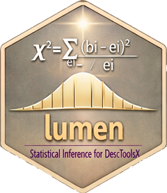

# 📦 lumen 

<!-- badges: start -->
[-blue.svg)](https://www.gnu.org/licenses/old-licenses/gpl-2.0.html)
[](https://github.com/AndriSignorell/lumen/actions/workflows/R-CMD-check.yaml)
<!-- badges: end -->

**Statistical Tests, Confidence Intervals and Distributions**

## 🧩 Overview

`lumen` is the inferential layer of the **DescToolsX ecosystem**. It
provides classical, robust, nonparametric and specialised hypothesis
tests, confidence intervals for the common estimands, and a set of
probability distributions that base R does not carry.

Tests return ordinary `"htest"` objects and intervals follow one
argument convention throughout, so procedures from very different
literatures can be combined without translating between interfaces.

The package is self-contained and does not require the higher-level
packages of the suite.

📖 **Documentation:** <https://andrisignorell.github.io/lumen/>

## ⚙️ Installation

``` r
install.packages("lumen")
```

Or the development version from GitHub:

``` r
remotes::install_github("AndriSignorell/lumen")
```

## 📚 Core Features

### 🔹 Location

-   `tTestSummary()`, `zTest()`, `yuenTTest()`, `signTest()`
-   `brunnerMunzelTest()`, `moodMedianTest()`, `vanDerWaerdenTest()`
-   `hotellingT2Test()` for multivariate means

### 🔹 Scale

-   `varTest()`, `leveneTest()`, `siegelTukeyTest()`, `mosesTest()`

### 🔹 Categorical Data

-   `barnardTest()`, `gTest()`, `pearsonChisqTest()`
-   `cochranArmitageTest()`, `mantelTrendTest()`, `cochranQTest()`
-   `breslowDayTest()`, `woolfTest()`
-   `bhapkarTest()`, `stuartMaxwellTest()`, `lehmacherTest()`

### 🔹 Goodness of Fit and Normality

-   `andersonDarlingTest()`, `cramerVonMisesTest()`, `lillieforsTest()`
-   `shapiroFranciaTest()`, `jarqueBeraTest()`
-   `hosmerLemeshowTest()`, `leCessieTest()` for logistic models

### 🔹 Multiple Comparisons and Post-hoc

-   `postHocTest()` with a `plot()` method, `signifDiff()`
-   `dunnTest()`, `dunnettTest()`, `conoverTest()`, `nemenyiTest()`
-   `gamesHowellTest()`, `scheffeTest()`, `steelTest()`, `dscfTest()`

### 🔹 Trend, Randomness and Time Series

-   `jonckheereTerpstraTest()`, `pageTest()`, `coxStuartTest()`
-   `runsTest()`, `bartelsRankTest()`, `vonNeumannTest()`
-   `adfTest()`, `kpssTest()`
-   `durbinWatsonTest()`, `breuschGodfreyTest()`, `breuschPaganTest()`

### 🔹 Correlation

-   `corTest()`, `corCI()`, `fisherZ()`, `fisherZInv()`

### 🔹 Confidence Intervals

-   Proportions: `binomCI()`, `binomDiffCI()`, `binomRatioCI()`,
    `binomPairedDiffCI()`, `hyperCI()`, `multinomCI()`
-   Counts and rates: `poissonCI()`, `poissonDiffCI()`,
    `poissonRatioCI()`
-   Location: `meanCI()`, `meanDiffCI()`, `medianCI()`, `medianDiffCI()`,
    `quantileCI()`, `sumCI()`
-   Scale: `varCI()`, `madCI()`, `madDiffCI()`, `madRatioCI()`
-   General: `bootCI()` for arbitrary statistics

### 🔹 Sample Size and Power

-   `binomCIn()`, `meanCIn()`, `powerChisqTest()`

### 🔹 Distributions

`dpqr` families for the Benford, Dirichlet, extreme value, Fréchet, GEV,
GPD, Gompertz, Gumbel, reversed Gumbel, order-statistic, reverse Weibull
and triangular distributions, the Anderson-Darling distribution
(`pAD()`, `qAD()`), plus mean and variance functions such as `mnorm()`,
`mbinom()` and `mgev()`.

### 🔹 Utilities

-   `scores()` for ordinal tables, `sphericityEps()` for repeated
    measures

## 🚀 Design Principles

-   **Consistent** — lowerCamelCase API, uniform argument names and
    ordering across the whole DescToolsX suite
-   **Standard output** — tests return `"htest"` objects and print like
    the ones in base R
-   **Fast** — exact and permutation engines (Barnard, Brunner-Munzel,
    Jonckheere-Terpstra with ties) and parallel bootstrap routines
    implemented in C++ via Rcpp, RcppArmadillo and RcppParallel
-   **Documented** — references to the original literature on every
    procedure

## 🧪 Example

``` r
library(lumen)

# a confidence interval for a proportion, several methods
binomCI(37, 100, method = c("wilson", "clopper-pearson", "wang"))

# nonparametric two-sample comparison without equal-variance assumption
brunnerMunzelTest(breaks ~ wool, data = warpbreaks)

# post-hoc comparisons after an ANOVA
fit <- aov(breaks ~ tension, data = warpbreaks)
postHocTest(fit, method = "hsd")

# goodness of fit
andersonDarlingTest(rnorm(100), null = "pnorm")
```

## 🧱 The Suite

`lumen` builds on `bedrock` (base utilities) and `pharos` (graphics).
`DescToolsX` (descriptive statistics), `alloy` (modelling), `pons`
(MS Office) and `swissValet` (RStudio addins) complete the family.

## 🙏 Acknowledgements

`lumen` builds on code and ideas from many authors, listed as
contributors in the DESCRIPTION file.

Parts of the code and documentation were reviewed with the help of large
language models (OpenAI Codex, Anthropic Claude). Every suggestion was
assessed, edited and verified by the maintainer, who remains solely
responsible for the content of this package.

## 📜 License

GPL (≥ 2)
